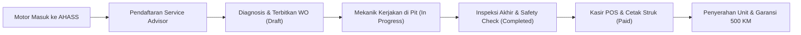

# MotoFlow AHASS Workshop System
### Sistem Informasi Manajemen Bengkel Resmi Honda AHASS, Kasir POS Billing, dan Inventaris Suku Cadang

[](https://golang.org)
[](https://vuejs.org)
[](https://www.postgresql.org)
[](https://tailwindcss.com)
[](https://www.docker.com)
[](.github/workflows/ci.yml)
[](https://online-thousands-tutorial-king.trycloudflare.com)

> **Portofolio Aplikasi Web Khusus Posisi "Programmer Junior" di PT Nusantara Sakti Group (NSS)**  
> *Dealer Resmi Honda, Bengkel AHASS, dan Perusahaan Multifinance Terbesar di Indonesia.*  
> 🌐 **Live Public Demo**: [https://online-thousands-tutorial-king.trycloudflare.com](https://online-thousands-tutorial-king.trycloudflare.com)

---

## 1. Ringkasan & Kualifikasi Lowongan PT Nusantara Sakti Group

Proyek **motoflow-workshop-system** dirancang secara khusus untuk membuktikan kesiapan teknis dan penguasaan arsitektur terhadap kualifikasi posisi Programmer Junior di PT Nusantara Sakti Group:

1. **Database Relasional PostgreSQL Berstandar Industri**:
   - DDL skema relasi lengkap dengan *Foreign Keys* berintegritas tinggi.
   - Kebijakan *Cascade Delete* terisolasi pada `work_order_items`.
   - *Advisory Lock* / transactional locking anti *race condition* untuk penomoran otomatis `WO-AHASS-YYYYMMDD-XXXX`.
   - Showcase query agregasi kompleks (`docs/reporting-queries.sql`): `JOIN`, `GROUP BY`, `SUM`, `COUNT`, `AVG`, dan *Window Functions*.
2. **Modern Backend (Golang & Gin Framework)**:
   - Perhitungan harga, diskon, dan PPN 11% bebas *floating-point drift* via library `shopspring/decimal`.
   - Arsitektur berlapis (*Controller-Service-DTO-Model*) dengan *Table-Driven Unit Tests*.
   - Mesin cetak struk kasir thermal (58mm/80mm ESC/POS) dan faktur resmi A4 via `jung-kurt/gofpdf`.
   - Autentikasi JWT dan Role-Based Access Control (Admin, Service Advisor, Kasir, Mekanik).
3. **Frontend Reaktif (Vue 3, TypeScript, Vite & Tailwind CSS)**:
   - Komponen SPA modern (*Single Page Application*) dengan *Composition API* (`<script setup>`).
   - Pinia state management terstruktur dan modular.
   - Desain antarmuka berstandar visual resmi Honda AHASS Racing Red (`#CC0000`).

---

## 2. Matriks Adaptasi Arsitektur ScrapFlow ke Domain AHASS

| Komponen Asal (ScrapFlow) | Domain Bengkel Resmi Honda AHASS (MotoFlow) | Implementasi Teknis |
| :--- | :--- | :--- |
| **Master Customer** | Pelanggan & Kendaraan Honda | Nama Pemilik, No. HP, No. Plat (`B 3456 KRF`), Model Motor (Vario 160, Beat, PCX), Odometer KM |
| **Master Items** | Honda Genuine Parts (HGP) & Jasa Servis | AHM Oil MPX1/MPX2/SPX2, Kampas Rem Cakram/Tromol, V-Belt, Busi NGK, Jasa Servis Lengkap |
| **Scale Details** | Work Order Items (Rincian Servis) | `price_snapshot`, kuantitas suku cadang, diskon per item, subtotal bebas floating drift |
| **Invoices** | Work Order & Service Invoices | Status alur servis: `Draft` &rarr; `In Progress` &rarr; `Completed` &rarr; `Paid` |
| **Fleet & Driver** | Mekanik & Service Advisor | Alokasi Pit Servis (Pit 1-4), spesialisasi injeksi/CVT, dan Service Advisor penerima motor |
| **Print Engine** | POS Thermal Slip & Faktur A4 | Struk kasir thermal (58mm/80mm) & dokumen formal faktur A4 tanda tangan ganda via GoFPDF |
| **Decimal Engine** | Financial Arithmetic Engine | Perhitungan PPN 11%, diskon, dan kembalian via library `github.com/shopspring/decimal` |
| **Protection** | Concurrency Lock | Penomoran SPK anti-tabrakan: `WO-AHASS-YYYYMMDD-XXXX` |

---

## 3. Struktur Monorepo Proyek

```
motoflow-workshop-system/
├── motoflow-backend/                  # RESTful API Service (Golang)
│   ├── config/                        # Koneksi Database (PostgreSQL & SQLite Fallback)
│   ├── controllers/                   # Handler HTTP (Auth, WO, Sparepart, Dashboard, Print)
│   ├── dto/                           # Request & Response Payload Validation
│   ├── middleware/                    # Autentikasi JWT, Role Permission & CORS
│   ├── models/                        # Entitas GORM (User, Customer, Sparepart, WorkOrder, dll)
│   ├── routes/                        # Registrasi Route Terpusat Gin
│   ├── seeders/                       # Data Seed Realistis Motor Honda & Suku Cadang HGP
│   ├── services/                      # Logika Finansial (Decimal) & Table-Driven Unit Tests
│   ├── docker-compose.yml             # Container PostgreSQL Lokal
│   └── main.go                        # Entry Point Server
│
├── motoflow-frontend/                 # Web SPA (Vue 3 + Vite + TypeScript)
│   ├── src/
│   │   ├── components/                # ThermalReceiptModal, A4InvoiceModal, Sidebar, Navbar
│   │   ├── layouts/                   # MainLayout Navigasi Responsif
│   │   ├── pages/                     # Dashboard, WorkOrderList, CreateWO, POS Billing, Inventory
│   │   ├── router/                    # Guard Autentikasi & Rute Halaman
│   │   ├── stores/                    # Pinia Store (Auth, WorkOrder, Sparepart, Customer)
│   │   ├── types/                     # Interface TypeScript
│   │   └── utils/                     # Formatter Mata Uang Rupiah & Status Badge
│   ├── package.json
│   └── vite.config.ts
│
├── docs/                              # Technical Showcase untuk HRD / User Teknis NSS
│   ├── database-schema.sql            # Skema Relasi DDL, Foreign Key, & Index PostgreSQL
│   ├── reporting-queries.sql          # Showcase Query SQL: JOIN, GROUP BY, SUM, COUNT, AVG
│   └── system-flowchart.md            # Diagram Alur Bisnis Servis AHASS (Mermaid)
└── README.md                          # Dokumentasi Utama
```

---

## 4. Alur Proses Bisnis Servis AHASS



> Diagram alur lengkap, Sequence Diagram interaksi, dan Entity-Relationship Diagram (ERD) tersedia di [docs/system-flowchart.md](docs/system-flowchart.md).

---

## 5. Akun Pengguna Demo (Akses Cepat 1-Click)

Tersedia tombol login demo otomatis pada halaman `/login`:

| Peran (Role) | Username | Password | Tanggung Jawab Operasional |
| :--- | :--- | :--- | :--- |
| **Kepala Bengkel (Admin)** | `admin` | `password123` | Akses seluruh dashboard eksekutif, data master, dan laporan omzet |
| **Service Advisor** | `advisor` | `password123` | Pendaftaran motor masuk, diagnosa keluhan, dan penerbitan SPK |
| **Kasir POS AHASS** | `kasir` | `password123` | Penyelesaian billing, input pembayaran, cetak struk kasir thermal |
| **Mekanik Senior** | `mekanik` | `password123` | Pelaksanaan pengerjaan servis di Pit 1 dan pengambilan suku cadang |

---

## 6. Showcase Fitur Utama

### A. Executive Workshop Dashboard
- **Omzet Hari Ini & MTD**: Agregasi *real-time* omset kotor, PPN 11%, dan jumlah unit motor yang diservis.
- **Top 5 Honda Genuine Parts**: Peringkat suku cadang terlaris berdasarkan kontribusi omset (misal: AHM Oil MPX2, Kampas Rem Cakram, V-Belt Kit).
- **Produktivitas Mekanik**: Pelacakan jumlah motor yang selesai diservis per Pit mekanik dan total pendapatan jasa mekanik.
- **Peringatan Stok Menipis**: Peringatan dini otomatis ketika stok fisik suku cadang berada di bawah batas minimum (`stock <= min_stock`).

### B. Kasir POS Billing & Engine Cetak Ganda
- **Pencegahan Floating-Point Drift**: Nilai moneter dikalkulasi menggunakan `shopspring/decimal` tanpa galat pembulatan IEEE-754.
- **Cetak Struk POS Thermal (58mm / 80mm)**: Format struk ESC/POS lengkap dengan header bengkel resmi AHASS Nusantara Sakti, data no. polisi plat motor, rincian part/jasa, PPN 11%, dan syarat garansi servis 500 KM.
- **Faktur Resmi Servis A4 (GoFPDF)**: Berkas PDF resmi berstandar A4 yang dihasilkan langsung dari backend Go, memuat rincian pekerjaan, tanda tangan ganda (*Pelanggan* & *Service Advisor*), serta stempel verifikasi digital AHASS.

---

## 7. Panduan Menjalankan Sistem (Local Setup)

### Prasyarat
- Go 1.24+ terpasang di sistem.
- Node.js v20+ dan npm terpasang.
- (Opsional) PostgreSQL 14+ atau Docker. *Backend secara cerdas mendukung SQLite otomatis untuk pengujian cepat jika PostgreSQL lokal belum aktif.*

### Langkah 1: Menjalankan Backend (Golang)
```bash
cd motoflow-backend

# Jalankan unit tests verifikasi finansial
go test -v ./...

# Jalankan linter vet
go vet ./...

# Jalankan server API (Port 8080)
go run main.go
```
*Saat pertama kali dijalankan, backend otomatis melakukan Auto-Migration dan men-seed data realistis pelanggan, motor Honda, suku cadang HGP, dan mekanik.*

### Langkah 2: Menjalankan Frontend (Vue 3)
```bash
cd motoflow-frontend

# Pasang dependensi
npm install

# Jalankan server pengembangan Vite (Port 5173)
npm run dev

# Untuk pengujian build produksi
npm run build
```

Buka peramban di `http://localhost:5173` dan masuk dengan salah satu akun demo.

---

## 8. Ringkasan Endpoint REST API

| Metode | Endpoint | Deskripsi | Akses Role |
| :--- | :--- | :--- | :--- |
| `POST` | `/api/v1/auth/login` | Otentikasi pengguna & pembuatan JWT | Publik |
| `GET` | `/api/v1/dashboard/summary` | Metrik omzet, unit servis, & low-stock alert | Terautentikasi |
| `GET` | `/api/v1/work-orders` | Daftar Work Order / Faktur Servis | Terautentikasi |
| `POST` | `/api/v1/work-orders` | Terbitkan Work Order baru & kurangi stok HGP | Service Advisor / Admin |
| `PATCH` | `/api/v1/work-orders/:id/status` | Update status: `in_progress`, `completed` | Mekanik / SA / Admin |
| `POST` | `/api/v1/work-orders/:id/pay` | Penyelesaian pembayaran kasir POS | Kasir / Admin |
| `GET` | `/api/v1/work-orders/:id/receipt` | Format teks struk kasir thermal (58mm/80mm) | Kasir / All |
| `GET` | `/api/v1/work-orders/:id/invoice-pdf` | Unduh dokumen faktur resmi A4 via GoFPDF | Kasir / All |
| `GET` | `/api/v1/spareparts` | Katalog Honda Genuine Parts & status stok | Terautentikasi |
| `PATCH` | `/api/v1/spareparts/:id/stock` | Penyesuaian stok masuk / keluar gudang | Admin / Staff |
| `GET` | `/api/v1/customers` | Master data pelanggan & nomor plat motor | Terautentikasi |
| `GET` | `/api/v1/mechanics` | Kinerja mekanik dan status Pit AHASS | Terautentikasi |

---

## 9. Showcase Query Pelaporan SQL

Seluruh query SQL agregasi tersedia di berkas [docs/reporting-queries.sql](docs/reporting-queries.sql):
- **Query 1**: Laporan Omset Harian & Bulanan Bengkel (`SUM`, `COUNT`, `AVG`, `GROUP BY DATE`).
- **Query 2**: Top 5 Honda Genuine Parts Terlaris (`JOIN`, `GROUP BY`, `ORDER BY omset DESC`).
- **Query 3**: Kinerja & Produktivitas Mekanik AHASS (`LEFT JOIN`, `AVG waktu pengerjaan`).
- **Query 4**: Notifikasi Peringatan Suku Cadang Menipis (`WHERE stock <= min_stock`).
- **Query 5**: Analisa Komparasi Omset Suku Cadang vs Jasa Servis (Revenue Mix).

---

## 10. Implementasi Fase 4: Production Maturity, Caching, Containerization & CI/CD

Sebagai bukti kesiapan ke tingkat *production-ready enterprise*, sistem telah dilengkapi dengan arsitektur Fase 4:

1. **High-Performance In-Memory & Redis Caching Layer (`services/cache_service.go`)**:
   - Caching thread-safe dengan TTL pada ringkasan dashboard eksekutif dan katalog suku cadang fast-moving.
   - *Cache Invalidation otomatis*: Cache metrik langsung di-reset begitu transaksi Work Order baru masuk, status diperbarui, atau kasir menyelesaikan pembayaran.
2. **Database Migration Management Resmi (`migrations/`)**:
   - `000001_create_initial_schema.up.sql` & `.down.sql`: DDL relasional PostgreSQL berstandar enterprise.
   - `000002_add_indexes_and_constraints.up.sql` & `.down.sql`: Composite covering indexes untuk performa tinggi pencarian plat motor dan nomor part.
3. **Containerization Multi-Stage Docker**:
   - **Backend Dockerfile**: Menggunakan `golang:1.24-alpine` sebagai builder dan `alpine:3.19` minimalis non-root user sebagai runtime dengan zona waktu Asia/Jakarta.
   - **Frontend Dockerfile**: Multi-stage build Node 20 dengan server reverse-proxy Nginx Alpine teroptimasi gzip.
   - **Docker Compose Orkestrasi Penuh (`docker-compose.yml`)**: Menggabungkan PostgreSQL 16, Redis 7, Golang API Backend, dan Vue 3 SPA Frontend.
4. **Automated CI/CD Pipeline (`.github/workflows/ci.yml`)**:
   - Otomatis menjalankan `go mod verify`, `go vet ./...`, `go test -v -race ./...`, kompilasi Go binary, dan `npm run build` pada setiap *push* atau *pull request* ke branch `main`.
5. **Live Public Tunneling Deployment**:
   - Terintegrasi dengan secure tunneling Cloudflare sehingga dapat diakses secara publik dan aman via protokol HTTPS.

---

## 11. Profil Pengembang & Lisensi
- **Pengembang**: **Frans Alwan** ([@fransalwan](https://github.com/fransalwan))
- **Email**: fransalwan55@gmail.com
- **Posisi Tujuan**: **Programmer Junior** — PT Nusantara Sakti Group (NSS)
- **Lisensi**: Proyek ini dilisensikan di bawah lisensi [MIT](LICENSE). Dibuat dengan dedikasi tinggi sebagai portofolio teknis komprehensif.
