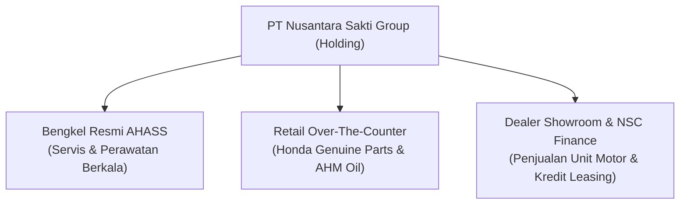

# Arsitektur Proses Bisnis & Finansial Domain NSS
### PT Nusantara Sakti Group: Dealer Honda, Bengkel AHASS, dan Pembiayaan NSC Finance

Dokumen ini menguraikan arsitektur proses bisnis, formula finansial, dan mekanisme integritas data yang diterapkan dalam sistem **MotoFlow**.

---

## 1. Tiga Pilar Bisnis PT Nusantara Sakti Group

1. **Bengkel Resmi AHASS (Astra Honda Authorized Service Station)**:
   * Menangani motor masuk, diagnosa keluhan (*symptoms*), penugasan pit mekanik (Pit 1–4), inspeksi keselamatan (*safety check*), billing kasir, dan penerbitan faktur bergaransi servis 500 KM / 7 hari kerja.
2. **Retail Suku Cadang HGP & AHM Oil**:
   * Penjualan langsung suku cadang resmi dan oli motor tanpa melalui tiket antrean servis mekanik, dilengkapi sistem promosi voucher dan pemindaian *barcode*.
3. **Showroom Penjualan Motor & NSC Finance**:
   * Penjualan unit motor baru Honda (*Matic, Sport, EV Listrik*), alokasi Nomor Rangka Astra (*VIN*) fisik, dan pembiayaan kredit cicilan melalui anak perusahaan pembiayaan **PT Nusa Surya Ciptadana (NSC Finance)**.

---

## 2. Formula Finansial & Standar Aritmatika Bebas Floating-Point Drift

Seluruh perhitungan finansial menggunakan tipe data presisi tinggi `decimal.Decimal` (via `github.com/shopspring/decimal`), mencegah galat pembulatan biner IEEE-754:

### A. Alur Kalkulasi Billing Servis AHASS
1. **Subtotal Suku Cadang** $\(S_{part}\)$:
   $$\sum_{i=1}^{n} (Price_i \times Qty_i \times (1 - \frac{Disc_i}{100}))$$
2. **Subtotal Jasa Mekanik** $\(S_{service}\)$:
   $$\sum_{j=1}^{m} (LaborPrice_j \times Qty_j \times (1 - \frac{Disc_j}{100}))$$
3. **Dasar Pengenaan Pajak (DPP)**:
   $$DPP = (S_{part} + S_{service}) - TotalPromoDiscount$$
4. **Pajak Pertambahan Nilai (PPN 11%)**:
   $$PPN = \text{round}(DPP \times 11\%)$$
5. **Grand Total Tagihan**:
   $$GrandTotal = DPP + PPN$$

---

### B. Formula Pembiayaan Kredit Cicilan NSC Finance

NSC Finance menggunakan metode perhitungan bunga flat (*Flat Rate Installment Engine*) sesuai regulasi Otoritas Jasa Keuangan (OJK):

1. **Uang Muka (DP)**:
   $$DP = OTR \times DP\% \quad (\text{Minimum 10\% s/d 50\%})$$
2. **Pokok Pinjaman (Principal Loan)**:
   $$P = OTR - DP$$
3. **Total Bunga Pembiayaan (Flat 18.00% per tahun = 1.5% per bulan)**:
   $$TotalInterest = P \times \left(\frac{18.00\%}{12}\right) \times TenorMonths$$
4. **Angsuran Pokok + Bunga per Bulan**:
   $$MonthlyInstallment = \text{ceil}\left(\frac{P + TotalInterest}{TenorMonths}\right)$$
5. **Total Pembayaran Pertama (Total Down Payment / TDP)**:
   $$TDP = DP + AdminFee + InsuranceTLO$$
   * Biaya Administrasi & Fidusia: Rp 450.000
   * Asuransi Kehilangan Total Loss Only (TLO): Rp 350.000

---

## 3. Mekanisme Keamanan Integritas Data & Anti Race-Condition

### A. Penomoran Dokumen Otomatis (WO & SPK)
Untuk mencegah nomor ganda saat jam sibuk kasir dan pendaftaran, sistem memanfaatkan **Transactional Locking & Advisory Lock**:
* Format Work Order: `WO-AHASS-YYYYMMDD-XXXX` (misal: `WO-AHASS-20261027-0001`)
* Format Surat Pemesanan Kendaraan: `SPK-NSS-YYYYMMDD-XXXX` (misal: `SPK-NSS-20261027-0001`)
* Format Invoice Kasir Retail: `INV-RET-YYYYMMDD-XXXX`

### B. Snapshot Harga & Identitas Suku Cadang
Harga dan nama suku cadang pada `work_order_items` disimpan sebagai **snapshot permanen** (`price_snapshot`, `part_number_snapshot`, `item_name_snapshot`). Jika di masa depan master data harga part dinaikkan oleh AHM, riwayat faktur masa lalu tidak akan terpengaruh.

### C. Ledger Inventaris Otomatis
Setiap kali Work Order baru diterbitkan atau transaksi retail OTC dibayarkan, sistem secara otomatis mengeksekusi mutasi stok:
* Mengurangi stok fisik suku cadang secara atomik (`stock = stock - qty`).
* Memicu peringatan dini (*Low Stock Alert*) jika sisa stok $\le$ batas minimum (`min_stock`).
* Menolak transaksi jika stok fisik tidak mencukupi (*Insufficient Stock Protection*).
