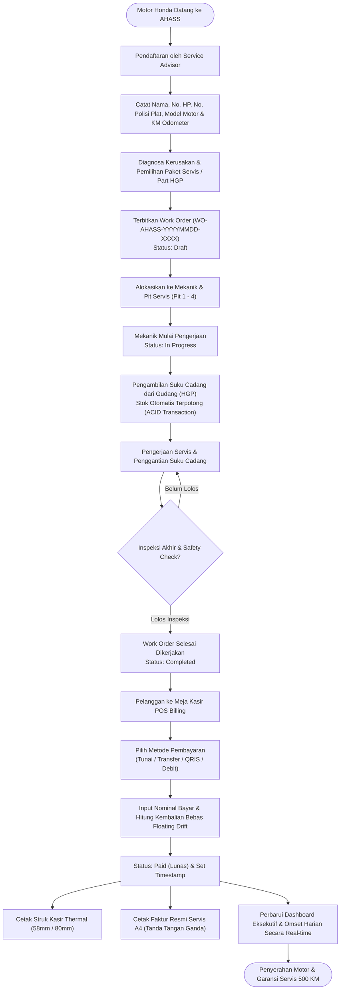
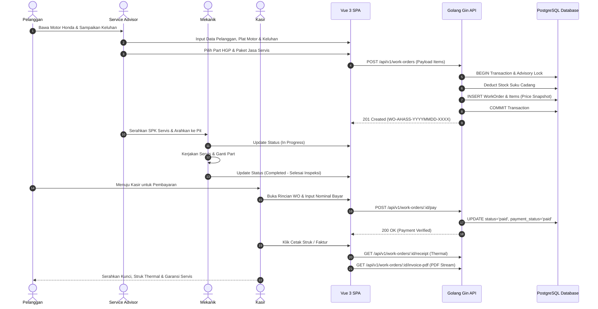
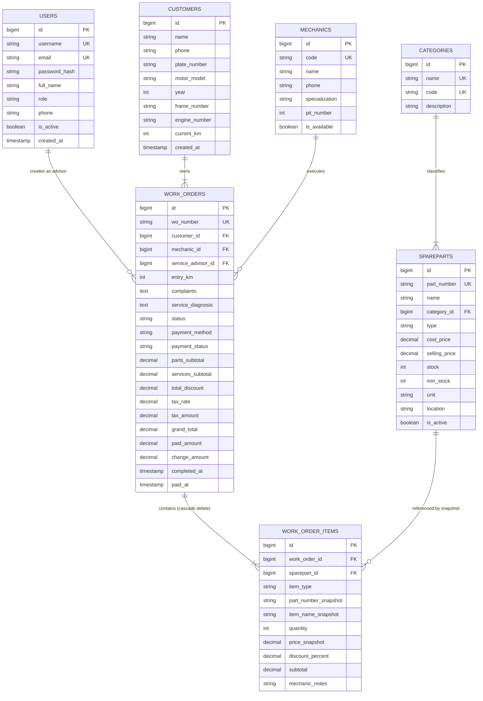

# Diagram Alur Sistem & Arsitektur MotoFlow AHASS
PT Nusantara Sakti Group (NSS) — Bengkel Resmi Honda

Dokumen ini memuat diagram alur proses bisnis operasional bengkel AHASS, sequence diagram interaksi komponen, serta diagram relasi entitas basis data (ERD).

---

## 1. Flowchart Alur Operasional Bengkel AHASS

---

## 2. Sequence Diagram Interaksi Komponen Sistem

---

## 3. Entity-Relationship Diagram (ERD)

